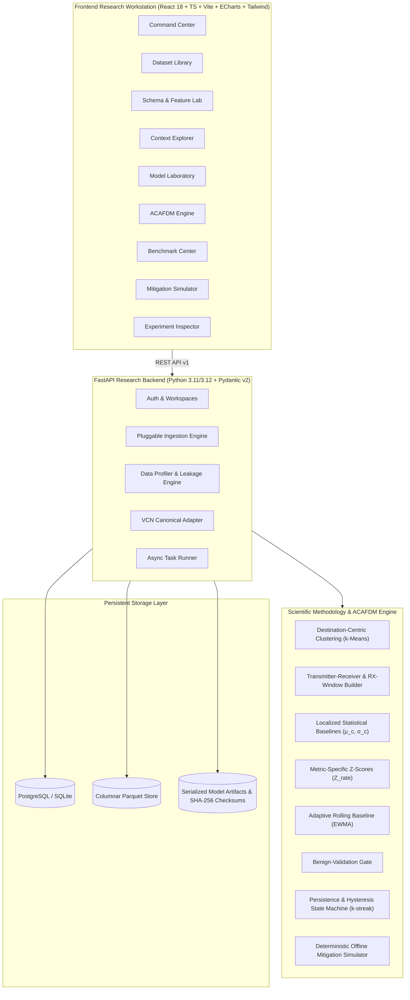

# FluxV2X (flux-v2x)

> **Observe context. Detect anomalies. Defend intelligently.**  
> *An extensible network-security research, analytics, and experimentation platform for vehicular communication networks.*

---

## 1. Overview & Research Mission

**FluxV2X** is an extensible research platform that addresses a critical open challenge in Intelligent Transportation Systems (ITS) and Vehicular Communication Networks (VCNs): **distinguishing benign traffic surges (induced by vehicular congestion and clustering) from malicious packet flooding attacks (DoS/DDoS).**

Traditional threshold-based or flat machine learning detectors typically treat all flow records as interchangeable. Under heavy traffic congestion (e.g. rush-hour bottlenecks or slow-moving highway traffic), legitimate vehicular broadcasts surge dramatically, generating severe false-alarm rates. Conversely, an attack launched in sparse free-flow traffic might fall below global thresholds, escaping detection.

FluxV2X resolves this through a dual-identity architecture:
1. **A General-Purpose Structured-Data Research Workbench:** Pluggable ingestion (CSV, TSV, JSON, JSONL, Parquet, Excel), schema profiling, cryptographic fingerprinting, and feature engineering.
2. **A Faithful Vehicular-Network Security Platform:** Faithful implementation of the research methodology from **Khan et al. (2026)** and the **ACAFDM** (Adaptive Context-Aware Malicious Flooding Detection and Mitigation) framework.

---

## 2. Research Foundation & Citations

FluxV2X implements and reproduces the methodology published in:

> **Base Paper:**  
> Khan, M. D., Nnamoko, N., Rafiq, H., and Abubahia, A., *"Congestion-context-aware spatiotemporal detection of malicious flooding in vehicular communication networks,"* **Vehicular Communications**, 60 (2026), Article 101045.  
> **DOI:** [10.1016/j.vehcom.2026.101045](https://doi.org/10.1016/j.vehcom.2026.101045)

> **Primary Dataset:**  
> *"A spatiotemporal, congestion-context-aware vehicular communication dataset for malicious flooding attack analysis,"* **Mendeley Data**, version 1.  
> **DOI:** [10.17632/2jvknhv465.1](https://doi.org/10.17632/2jvknhv465.1)

---

## 3. System Architecture



---

## 4. Key Mathematical Formulations

### 4.1 Localized Statistical Baselines & Contextual Z-Scores (Khan et al. 2026)
Vehicular communication traces are grouped into localized spatiotemporal clusters $c \in \{1, \dots, k\}$ based on receiver trajectory descriptors $(rx_x, rx_y, rx_{speed})$.
Within cluster $c$, the localized baseline parameters for benign packet rates are computed:
$$\mu_c = \frac{1}{|N_c|} \sum_{i \in N_c} x_i, \quad \sigma_c = \sqrt{\frac{1}{|N_c|} \sum_{i \in N_c} (x_i - \mu_c)^2}$$
For each incoming flow observation, metric-specific contextual deviation features are derived:
$$Z_{rate} = \frac{x_{rate} - \mu_c}{\sigma_c + \epsilon}, \quad \Delta_{rate} = \frac{x_{rate}}{\mu_c + \epsilon}$$

### 4.2 ACAFDM Adaptive Rolling Baselines & Poison-Resistant Gate
Under traffic evolution, normal baseline statistics adapt dynamically via an Exponentially Weighted Moving Average (EWMA):
$$\mu_c(t) = (1 - \alpha) \mu_c(t - 1) + \alpha x(t)$$
$$\sigma_c(t) = (1 - \alpha) \sigma_c(t - 1) + \alpha |x(t) - \mu_c(t)|$$
**Benign-Validation Gate (Poison Prevention):**
$$\text{Update Permitted} \iff |Z_{rate}| < Z_{threshold} \land \hat{P}(\text{attack}) < \tau_{confidence}$$
If an observation exceeds the deviation or confidence threshold, the update is blocked, preventing malicious floods from shifting the baseline upwards.

### 4.3 Paired Two-Tailed McNemar Test
To statistically evaluate classifier $A$ (Raw) vs $B$ (Contextual) on paired test predictions:
$$\chi^2 = \frac{(|b - c| - 1)^2}{b + c}, \quad p = P(\chi^2_1 \ge \text{stat})$$
where $b$ is the count of observations correctly predicted by $A$ and missed by $B$, and $c$ is the count correctly predicted by $B$ and missed by $A$.

---

## 5. Supported Model Families (10 Models)

FluxV2X provides 10 reproducible classifier implementations:
1. **Global Traffic-Rate Threshold Detector** (Non-contextual baseline)
2. **Raw Gradient Boosting** (Non-contextual)
3. **Contextual Gradient Boosting** (Primary base paper method)
4. **Random Forest Classifier**
5. **Extra Trees Classifier**
6. **AdaBoost Classifier**
7. **Decision Tree Classifier**
8. **K-Nearest Neighbors (KNN)**
9. **Logistic Regression**
10. **Support Vector Machine (Linear & RBF Kernels)**

---

## 6. Quick Start & Local Execution

### Prerequisites
- Python 3.11+ with [`uv`](https://github.com/astral-sh/uv)
- Node.js 20+ with `npm`

### Step 1: Start the Backend
```powershell
cd backend
uv sync --extra dev
uv run pytest -v
uv run uvicorn app.main:app --host 127.0.0.1 --port 8000
```
*The database automatically creates tables and provisions the calibrated Khan et al. (2026) research dataset.*

### Step 2: Start the Frontend
```powershell
cd frontend
npm install
npm run dev
```
Open **[http://127.0.0.1:5173/](http://127.0.0.1:5173/)** to access the research dashboard.

---

## 7. Docker Compose Production Deployment

```bash
docker compose up -d --build
```
- Frontend: `http://localhost:5173`
- Backend API Docs: `http://localhost:8000/docs`
- PostgreSQL: `localhost:5432`

---

## 8. Automated Verification & Test Results

- **Backend Pytest Suite:** `14 passed in 17.91s (100% passing)`
  - Data ingestion, format sniffing, SHA-256 fingerprinting
  - Spatiotemporal clustering & localized baselines
  - Disjoint scenario partitioning (zero trajectory leakage)
  - Edwards-corrected two-tailed McNemar test
  - ACAFDM poison prevention gate & persistence policy
  - Deterministic offline mitigation simulator
- **Frontend Vite Build:** `✓ 2190 modules transformed, built in 26.09s (0 TypeScript errors)`
- **End-to-End Browser Session:** Verified across all 10 application views with interactive ECharts.

---

## 9. License & Attribution

- **Source Code:** Released under the MIT License.
- **Research Attribution:** Incorporates methodology from Khan et al. (2026) and Mendeley Data (CC BY 4.0).
