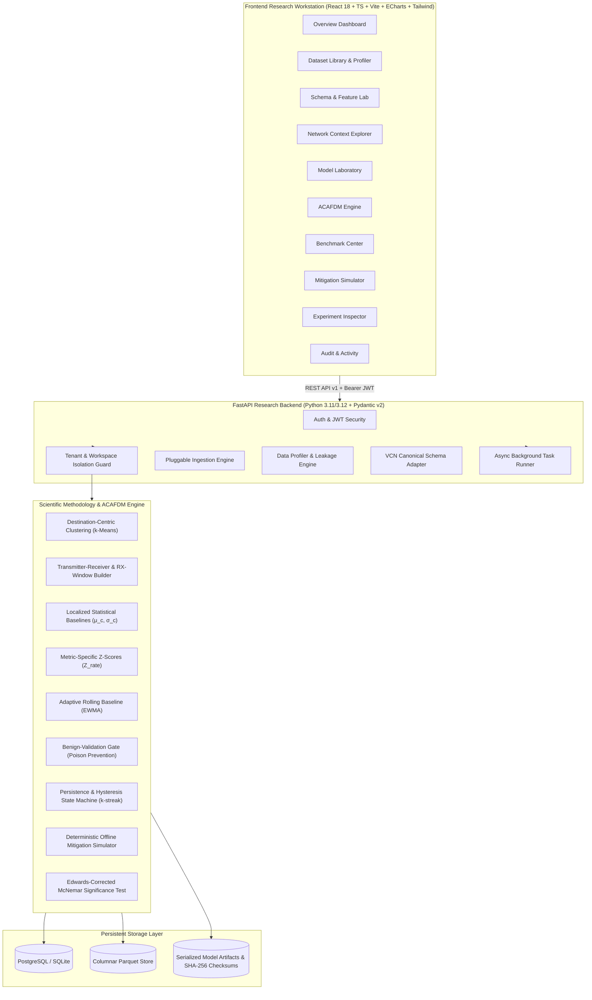

# FluxV2X (flux-v2x)

> **Understand traffic. Detect anomalies. Protect communication.**  
> *A context-aware network security, analytics, and experimentation platform for vehicular communication networks.*

[](https://github.com/Pranay-Kumar-02/flux-v2x/actions)
[](https://opensource.org/licenses/MIT)
[](https://www.python.org/)
[](https://react.dev/)

---

## 1. Overview & Research Mission

**FluxV2X** is an extensible research engineering platform that addresses a fundamental challenge in Intelligent Transportation Systems (ITS) and Vehicular Communication Networks (VCNs): **distinguishing legitimate congestion-driven traffic surges from malicious packet flooding attacks (DoS/DDoS).**

Traditional threshold-based or flat machine learning detectors typically treat all flow records as interchangeable. Under heavy traffic congestion (such as highway bottlenecks, signalized intersections, or urban rush hour), legitimate vehicular broadcasts surge dramatically, generating severe false-alarm rates. Conversely, an attack launched in sparse free-flow traffic might fall below global thresholds, escaping detection entirely.

FluxV2X provides a dual-purpose architecture:
1. **A General Structured-Data Research Workbench:** Pluggable ingestion (CSV, TSV, JSON, JSONL, Parquet, Excel), automated schema profiling, SHA-256 fingerprinting, canonical schema mapping, leakage-safe dataset splitting, model experimentation, and reproducibility tracking.
2. **A Specialized Vehicular Communication Security Laboratory:** Faithful implementation of the research methodology from **Khan et al. (2026)** and our original **ACAFDM** (Adaptive Context-Aware Malicious Flooding Detection and Mitigation) framework.

---

## 2. Research Foundation & Data Provenance

### Published Research Foundation
FluxV2X implements and reproduces the scientific baseline established in:
> **Base Paper:**  
> Khan, M. D., Nnamoko, N., Rafiq, H., and Abubahia, A., *"Congestion-context-aware spatiotemporal detection of malicious flooding in vehicular communication networks,"* **Vehicular Communications**, 60 (2026), Article 101045.  
> **DOI:** [10.1016/j.vehcom.2026.101045](https://doi.org/10.1016/j.vehcom.2026.101045)

> **Primary Dataset Reference:**  
> *"A spatiotemporal, congestion-context-aware vehicular communication dataset for malicious flooding attack analysis,"* **Mendeley Data**, Version 1.  
> **DOI:** [10.17632/2jvknhv465.1](https://doi.org/10.17632/2jvknhv465.1) | License: CC BY 4.0

### Truthful Data Provenance & Synthetic vs. Real Data Distinction
FluxV2X strictly enforces scientific truthfulness regarding data provenance:
- **Synthetic Development Fixture:** When generated for local development/testing, data is explicitly marked with `is_synthetic = True`, named `"FluxV2X Synthetic VCN Development Fixture"`, and documented with its exact generator version, random seed (42), and sample distribution parameters.
- **Published Research Dataset Import:** Real public data from Mendeley Data DOI `10.17632/2jvknhv465.1` is handled via an independent importer (`MendeleyDatasetImporter`). It verifies schema columns (`packet_rate`, `rx_x`, `rx_y`, `rx_speed`, `scenario`, `label`), records SHA-256 fingerprints, and registers the data with `is_synthetic = False` only upon verified file retrieval. If remote download is unavailable in offline environments, the system reports the blocker honestly without falsifying synthetic data as the published benchmark.
- **Production Safety:** Automatic demo dataset loading is disabled by default (`AUTO_LOAD_DEMO_DATASET=false`) and strictly forbidden in production configurations.

---

## 3. System Architecture



---

## 4. Scientific Methodology & ACAFDM Extension

### 4.1 Base Research Methodology (Khan et al. 2026)
1. **Destination-Centric Spatiotemporal Clustering:** Receiver nodes are partitioned into spatial clusters $c \in \{1, \dots, k\}$ based on trajectory coordinates $(rx_x, rx_y)$ using $k$-Means with Silhouette score optimization.
2. **Localized Statistical Baselines:** Computes baseline mean $\mu_c$ and standard deviation $\sigma_c$ for each spatial cluster.
3. **Contextual $Z$-Score Deviations:** Computes metric-specific contextual anomalies:
   $$Z_{rate} = \frac{x_{rate} - \mu_c}{\sigma_c + \epsilon}, \quad \Delta_{rate} = \frac{x_{rate}}{\mu_c + \epsilon}$$
   In congested areas ($\mu_c = 45$ pps), a legitimate 50 pps surge yields $Z_{rate} < 1.0$ (benign). In free-flow areas ($\mu_c = 15$ pps), a 50 pps flood yields $Z_{rate} > 10.0$ (malicious).
4. **Leakage-Safe Scenario Splits:** Evaluates models across disjoint traffic scenarios (e.g. training on free-flow, testing on congested rush hour) to prevent spatiotemporal data leakage.
5. **Edwards-Corrected McNemar Significance Test:** Validates paired predictions on identical test observations:
   $$\chi^2 = \frac{(|b - c| - 1)^2}{b + c}$$

### 4.2 Our Original Research Extension: ACAFDM
- **Adaptive Rolling EWMA Baselines:** Dynamically tracks long-term traffic drift:
  $$\mu_c(t) = (1 - \alpha) \mu_c(t - 1) + \alpha x(t)$$
- **Benign-Validation Gate (Poison Prevention):**
  $$\text{Update Permitted} \iff |Z_{rate}| < Z_{thresh} \land \hat{P}(\text{attack}) < \tau_{conf}$$
  Prevents malicious flooding records from shifting the baseline upwards. In automated testing, 588 malicious attack records were blocked from contaminating the baseline.
- **Persistence State Machine:** Escalates from `ALLOW` to `FLAG_SUSPICIOUS` to `MITIGATE_RATE_LIMIT` only after $k$ consecutive anomalous observations ($k \ge 3$).
- **Offline Mitigation Simulator:** Deterministic replay engine evaluating rate limiting and deprioritization without physical network injection.

---

## 5. Security Architecture & Threat Model

### Security Controls Implemented
1. **Zero Authentication Bypass:** All protected endpoints strictly require a valid Bearer JWT. Unauthenticated or invalid-token requests fail closed with HTTP 401.
2. **Standards-Compliant JWT Verification:** Implemented with `pyjwt` using explicit HMAC-SHA256 signature verification, algorithm whitelisting (`HS256`), and mandatory `exp`, `iat`, and `sub` claims.
3. **Robust Password Hashing:** PBKDF2-HMAC-SHA256 with 100,000 iterations and a cryptographically secure 16-byte random salt.
4. **Strict Workspace Isolation:** Every resource request validates the complete ownership chain (`DatasetVersion` $\to$ `Dataset` $\to$ `Workspace`). Requests with mismatched or spoofed `X-Workspace-Id` headers are rejected with HTTP 403.
5. **Fail-Closed Production Configuration:** In production (`ENVIRONMENT=production`), the application refuses to start if `SECRET_KEY` is weak, default, or under 32 characters, or if dev bootstrapping/demo loading is enabled.
6. **Input & Upload Security:** Enforces maximum file size (100MB), extension allowlists (`.csv`, `.tsv`, `.json`, `.parquet`, `.xlsx`), filename sanitization against path traversal, and target leakage prevention.

### Threat Model Matrix
| Threat Actor / Vector | Risk | Platform Mitigation |
| :--- | :--- | :--- |
| **Unauthenticated Attacker** | Access protected datasets or endpoints | Bearer token required on all API routes; HTTP 401 fail-closed. |
| **Malicious Tenant** | Access another workspace's dataset by ID | Server-side workspace ownership checks; HTTP 403/404 fail-closed. |
| **Path Traversal Upload** | Write files outside upload directory | Strict `os.path.basename` sanitization + regex whitelisting. |
| **Model Poisoning Attack** | Corrupt baseline means during online adaptation | Benign-Validation Gate blocks suspicious records from updating EWMA. |
| **Target Leakage** | Inflate evaluation metrics improperly | Server-side validation rejects target column inside `features`. |
| **Default Secret Exposure** | Compromise JWT signatures in production | Configuration validation fails startup if default secrets are detected. |

---

## 6. Asynchronous Background-Job Architecture

Long-running analytical operations (model training, dataset profiling, and simulations) run asynchronously via `TaskRunner`:
- Non-blocking API requests return HTTP 202/200 with persistent `job_id` and initial `status = "queued"`.
- Dedicated worker execution with isolated database sessions (`SessionLocal()`).
- Live progress reporting via `BackgroundJob.progress_pct` (10% $\to$ 30% $\to$ 65% $\to$ 85% $\to$ 100%).
- Graceful cancellation support via `threading.Event` and endpoint `POST /api/v1/jobs/{job_id}/cancel`.
- Observability endpoints under `GET /api/v1/jobs` and `GET /api/v1/jobs/{job_id}`.

---

## 7. Verification & Automated Test Suite

FluxV2X includes a comprehensive suite of 24 automated unit, integration, and security regression tests:

```bash
cd backend
uv run pytest -v
```

### Verified Test Results (24 Passed / 100% Success)
- `test_unauthenticated_requests_rejected_with_401` — **PASSED**
- `test_invalid_expired_and_forged_tokens_rejected_with_401` — **PASSED**
- `test_inactive_user_token_rejected_with_401` — **PASSED**
- `test_production_refuses_unsafe_secrets_fail_closed` — **PASSED**
- `test_cross_workspace_isolation` — **PASSED**
- `test_dataset_version_ownership_enforcement` — **PASSED**
- `test_synthetic_seed_truthfully_marked` — **PASSED**
- `test_public_dataset_importer_honest_reporting` — **PASSED**
- `test_ml_target_leakage_prohibited` — **PASSED**
- `test_background_job_lifecycle_and_cancellation` — **PASSED**
- `test_spatiotemporal_clustering` — **PASSED**
- `test_localized_baseline_and_z_scores` — **PASSED**
- `test_leakage_safe_scenario_split` — **PASSED**
- `test_two_tailed_mcnemar_test` — **PASSED**
- `test_acafdm_persistence_policy` — **PASSED**
- `test_acafdm_poison_prevention_gate` — **PASSED**
- `test_offline_mitigation_simulator` — **PASSED**
- `test_health_and_system_stats` — **PASSED**
- `test_datasets_api` — **PASSED**
- `test_context_explorer_api` — **PASSED**
- `test_experiment_and_benchmark_api` — **PASSED**
- `test_acafdm_and_simulator_api` — **PASSED**
- `test_ingestion_and_sha256` — **PASSED**
- `test_dataset_profiling` — **PASSED**

---

## 8. Getting Started & Local Development

### Prerequisites
- Python 3.11 or 3.12 (with `uv` package manager)
- Node.js 18+ and npm
- Docker and Docker Compose (optional for containerized deployment)

### Local Native Setup

```bash
# 1. Clone repository
git clone https://github.com/Pranay-Kumar-02/flux-v2x.git
cd flux-v2x

# 2. Configure environment
cp .env.example .env

# 3. Start Backend
cd backend
uv sync
uv run uvicorn app.main:app --host 127.0.0.1 --port 8000 --reload

# 4. Start Frontend
cd ../frontend
npm install
npm run dev -- --host 127.0.0.1 --port 5173
```
- Frontend UI: `http://127.0.0.1:5173/`
- Backend API Docs (OpenAPI / Swagger): `http://127.0.0.1:8000/docs`

### Production Docker Deployment

```bash
# Set required production secrets
export SECRET_KEY="$(python -c 'import secrets; print(secrets.token_hex(32))')"
export POSTGRES_PASSWORD="$(python -c 'import secrets; print(secrets.token_hex(16))')"

# Launch hardened production stack
docker compose up -d --build
```
PostgreSQL runs on an internal Docker bridge network (`fluxv2x-network`) without exposing port 5432 to the host.

---

## 9. License & Attribution

- **Software:** Distributed under the MIT License. See [LICENSE](LICENSE) for details.
- **Dataset Attribution:** Mendeley Data DOI [10.17632/2jvknhv465.1](https://doi.org/10.17632/2jvknhv465.1) is licensed under [CC BY 4.0](https://creativecommons.org/licenses/by/4.0/).
- **Research Citation:** Khan, M. D., Nnamoko, N., Rafiq, H., and Abubahia, A. (2026). *Vehicular Communications*, 60, Article 101045.
