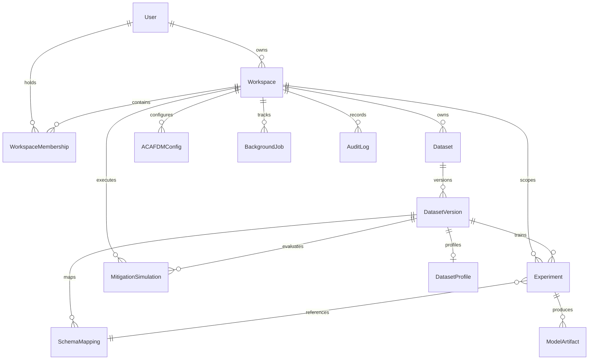

# FluxV2X Data Model & Entity Specifications

This document defines the relational database schema, entities, constraints, and multi-tenant chain-of-custody relationships for the FluxV2X platform.

---

## 1. Entity-Relationship Diagram (ERD)



---

## 2. Core Relational Entities

### 2.1 Identity & Tenant Boundaries

#### `users`
Represents an authenticated user within the system.
- `id` (String[36], PK): UUID identifier.
- `email` (String[255], Unique, Indexed, Not Null): RFC 5322 compliant email address.
- `full_name` (String[255], Not Null): Display name.
- `hashed_password` (String[255], Not Null): PBKDF2-HMAC-SHA256 salted hash.
- `is_active` (Boolean, Default: True): Account active status.
- `is_superuser` (Boolean, Default: False): Administrative flag.
- `created_at`, `updated_at` (DateTime): Timestamps in UTC.

#### `workspaces`
Top-level multi-tenant boundary. All datasets, experiments, and jobs belong to a single workspace.
- `id` (String[36], PK): UUID identifier.
- `name` (String[255], Not Null): Workspace display name.
- `slug` (String[255], Unique, Indexed, Not Null): URL-friendly slug.
- `description` (Text, Nullable): Workspace description.
- `owner_id` (String[36], FK `users.id`, Not Null): Primary workspace owner.
- `created_at` (DateTime): Creation timestamp in UTC.

#### `workspace_memberships`
Role-Based Access Control mapping users to authorized workspaces.
- `id` (String[36], PK): UUID identifier.
- `workspace_id` (String[36], FK `workspaces.id`, Not Null).
- `user_id` (String[36], FK `users.id`, Not Null).
- `role` (String[50], Default: `researcher`): Permitted roles: `owner`, `researcher`, `viewer`.
- `created_at` (DateTime): Membership creation timestamp.

---

### 2.2 Data Ingestion & Provenance Entities

#### `datasets`
Logical container for uploaded or imported network traffic datasets.
- `id` (String[36], PK): UUID identifier.
- `workspace_id` (String[36], FK `workspaces.id`, Not Null): Tenant scoping.
- `name` (String[255], Not Null): Dataset name.
- `description` (Text, Nullable): Dataset summary.
- `file_format` (String[50], Not Null): Format (`parquet`, `csv`, `json`).
- `file_path` (String[512], Not Null): Relative storage path on disk.
- `file_size_bytes` (Integer): Exact byte size on disk.
- `sha256_hash` (String[64], Not Null): Cryptographic integrity digest.
- `row_count` (Integer): Total records.
- `column_count` (Integer): Total features/attributes.
- `is_synthetic` (Boolean, Default: False): Strict indicator of synthetic generator origin.
- `provenance` (String[255]): Source attribution (e.g., `FluxV2X Synthetic VCN Generator v1.0` or `Mendeley Data DOI 10.17632/2jvknhv465.1`).
- `created_at` (DateTime): Ingestion timestamp.

#### `dataset_versions`
Immutable physical revisions of a dataset.
- `id` (String[36], PK): UUID identifier.
- `dataset_id` (String[36], FK `datasets.id`, Not Null).
- `version_num` (Integer, Default: 1): Monotonically increasing revision number.
- `file_path` (String[512], Not Null): Storage path for this specific immutable version.
- `row_count`, `column_count` (Integer): Dimensions for this version.
- `sha256_hash` (String[64], Not Null): Cryptographic checksum.
- `parent_version_id` (String[36], Nullable): Lineage parent ID for derived datasets.
- `transformation_metadata` (JSON, Nullable): Parameters of transformations applied.
- `created_at` (DateTime): Version timestamp.

#### `dataset_profiles`
Statistical profile computed by Polars during ingestion.
- `id` (String[36], PK): UUID identifier.
- `dataset_version_id` (String[36], FK `dataset_versions.id`, Unique, Not Null).
- `profile_data` (JSON, Not Null): Serialized dictionary of per-column metrics (nulls, types, min, max, mean, std).

#### `schema_mappings`
Maps raw dataset attributes to canonical domain entities (e.g., VCN features: `packet_rate`, `receiver_id`, `x_coord`, `y_coord`, `label`).
- `id` (String[36], PK): UUID identifier.
- `dataset_version_id` (String[36], FK `dataset_versions.id`, Not Null).
- `name` (String[255], Not Null): Schema mapping name.
- `target_domain` (String[50], Default: `vcn`): Target schema domain.
- `target_label` (String[100], Nullable): Designated classification label.
- `column_mappings` (JSON): Raw column to canonical column mapping.
- `feature_configs` (JSON): Scaling, exclusion, and clustering configs.

---

### 2.3 Experiments, Models & Benchmarks

#### `experiments`
Records machine learning model training sessions.
- `id` (String[36], PK): UUID identifier.
- `workspace_id` (String[36], FK `workspaces.id`, Not Null): Tenant scoping.
- `dataset_version_id` (String[36], FK `dataset_versions.id`, Not Null).
- `schema_mapping_id` (String[36], FK `schema_mappings.id`, Nullable).
- `name` (String[255], Not Null): Experiment identifier name.
- `target_column` (String[100], Default: `label`): Ground truth target.
- `model_family` (String[100], Not Null): `random_forest`, `gradient_boosting`, `mlp`, `decision_tree`, `logistic_regression`.
- `hyperparameters` (JSON): Configured estimator parameters.
- `split_strategy` (String[50], Default: `scenario_split`): `scenario_split`, `chronological`, `stratified`.
- `test_size` (Float, Default: 0.25): Held-out test ratio.
- `random_seed` (Integer, Default: 42): Fixed pseudo-random seed.
- `status` (String[50], Default: `queued`): `queued`, `running`, `completed`, `failed`.
- `metrics` (JSON, Nullable): Genuine computed metrics (`accuracy`, `precision`, `recall`, `f1_score`, `roc_auc`, `mcc`).
- `confusion_matrix` (JSON, Nullable): Evaluated 2x2 confusion matrix (`tn`, `fp`, `fn`, `tp`).
- `duration_seconds` (Float): Total training duration.
- `created_at`, `finished_at` (DateTime): Execution timestamps.

#### `model_artifacts`
Trained estimator files serialized to disk.
- `id` (String[36], PK): UUID identifier.
- `experiment_id` (String[36], FK `experiments.id`, Not Null).
- `artifact_path` (String[512], Not Null): File location (e.g., `data/models/{id}.joblib`).
- `artifact_type` (String[50], Default: `joblib`).
- `sha256_hash` (String[64], Not Null): Checksum of the saved model weights.

---

### 2.4 ACAFDM & Mitigation Simulator Entities

#### `acafdm_configs`
Parameters for the Adaptive Context-Aware Malicious Flooding Detection engine.
- `id` (String[36], PK): UUID identifier.
- `workspace_id` (String[36], FK `workspaces.id`, Not Null).
- `name` (String[255], Not Null): Configuration profile name.
- `cluster_count` (Integer, Default: 4): Number of receiver clusters ($k$).
- `rolling_window_size` (Integer, Default: 50): Sliding observations per cluster.
- `alpha_update_rate` (Float, Default: 0.1): Exponential moving average weight ($\alpha$).
- `z_threshold` (Float, Default: 2.5): Anomaly sensitivity standard deviations ($Z_{thresh}$).
- `persistence_k` (Integer, Default: 3): Consecutive anomaly streak required before mitigation ($K$).
- `cooldown_seconds` (Integer, Default: 30): Reset interval after benign recovery.
- `benign_validation_gate` (Boolean, Default: True): Dual-gate poison prevention switch.

#### `mitigation_simulations`
Simulated defensive policy evaluations.
- `id` (String[36], PK): UUID identifier.
- `workspace_id` (String[36], FK `workspaces.id`, Not Null).
- `dataset_version_id` (String[36], FK `dataset_versions.id`, Not Null).
- `acafdm_config_id` (String[36], FK `acafdm_configs.id`, Nullable).
- `name` (String[255], Not Null): Simulation name.
- `policy_action` (String[50], Default: `selective_rate_limiting`).
- `rate_limit_ratio` (Float, Default: 0.5): Throttle intensity.
- `priority_preservation` (Boolean, Default: True): Safety message exemption.
- `results` (JSON): Drop counts, latency overhead, and preservation rate.

#### `background_jobs`
Asynchronous job tracking.
- `id` (String[36], PK): UUID identifier.
- `workspace_id` (String[36], FK `workspaces.id`, Not Null).
- `job_type` (String[100], Not Null): Task category (e.g., `train_model`).
- `status` (String[50], Default: `pending`): `pending`, `processing`, `completed`, `failed`, `cancelled`.
- `progress_pct` (Integer, Default: 0): 0 to 100 progress indicator.
- `error_message` (Text, Nullable): Diagnostic error string on failure.
- `result_metadata` (JSON, Nullable): Task output summaries.
- `created_at`, `updated_at` (DateTime): Execution tracking timestamps.

---

## 3. Multi-Tenant Chain of Custody Enforcement

To prevent cross-tenant enumeration or privilege escalation, all queries enforce the complete ownership chain:
```sql
SELECT v.* 
FROM dataset_versions v
JOIN datasets d ON d.id = v.dataset_id
WHERE v.id = :version_id 
  AND d.workspace_id = :authorized_workspace_id;
```
If this join yields zero records, the API returns HTTP 404 (or 403), completely shielding data existence from unauthorized tenants.
