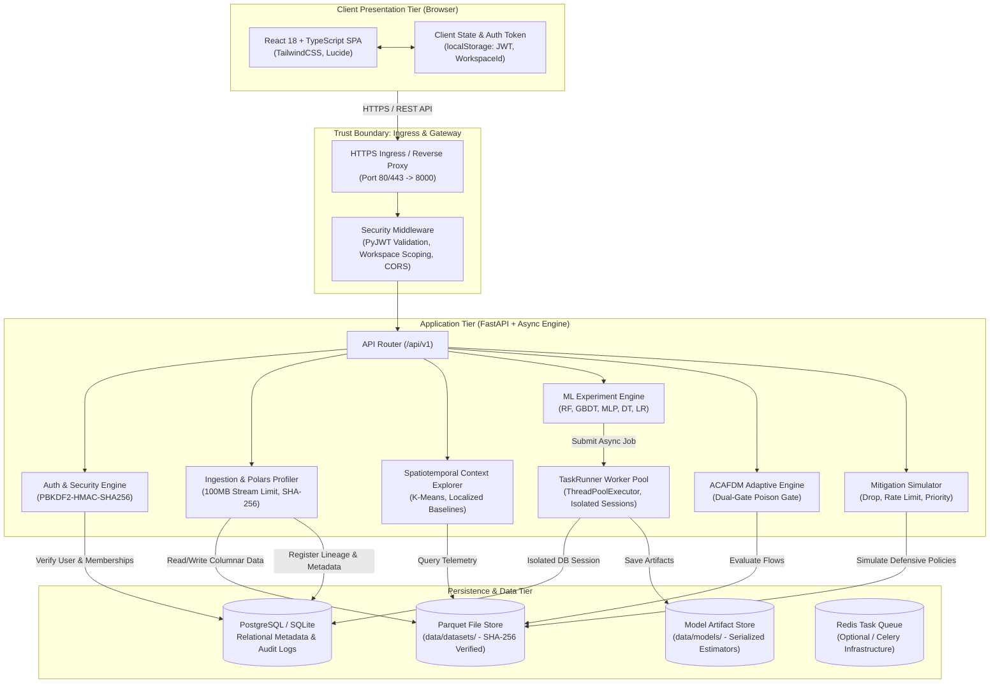

# FluxV2X System Architecture

## 1. Architectural Overview

FluxV2X is designed as a modern, decoupled, multi-tenant engineering platform. It comprises a client-side Single Page Application (SPA) built with React and TypeScript, a high-throughput asynchronous REST API powered by FastAPI and Polars, a relational PostgreSQL/SQLite metadata store, local/remote columnar file storage, and an asynchronous worker execution engine.

---

## 2. System Architecture Diagram

---

## 3. Component Details & Module Responsibilities

### 3.1 Frontend Presentation Tier
- **Framework**: React 18, TypeScript 5, Vite 5, TailwindCSS 3.
- **Routing**: Tabular view navigation (`Command Center`, `Dataset Library`, `Schema & Feature Lab`, `Network Context Explorer`, `Model Laboratory`, `ACAFDM Engine`, `Benchmark Center`, `Mitigation Simulator`, `Audit & System Health`).
- **State Management**: Token-based authentication with `localStorage` persistence (`fluxv2x_access_token`, `fluxv2x_workspace_id`). Every outgoing HTTP request automatically injects `Authorization: Bearer <token>` and `X-Workspace-Id: <id>`.

### 3.2 Security & Authentication Layer
- **Token Cryptography**: `PyJWT` issuing signed `HS256` tokens with strict signature validation, expiration checking (`exp`), and subject identification (`sub`).
- **Credential Storage**: Passwords hashed with PBKDF2-HMAC-SHA256, 100,000 iterations, and unique 16-byte cryptographically secure random salts.
- **Multi-Tenant Authorization**: Every protected route resolves the active workspace through `get_current_workspace`, strictly verifying membership in the database. Requests targeting unauthorized workspaces are rejected with HTTP 403 Forbidden.

### 3.3 Ingestion & Profiling Engine
- **Streaming Ingestion**: Uploads are chunked and monitored with a strict 100MB bound (`MAX_UPLOAD_SIZE_BYTES`). Exceeding payloads are rejected with HTTP 413.
- **Path Sanitization**: Filenames are sanitized using `os.path.basename` to prevent directory traversal. Permitted file extensions: `.csv`, `.parquet`, `.json`.
- **Columnar Engine**: Uses Apache Arrow and `Polars` for fast schema inference, null counts, statistical min/max/mean calculations, and SHA-256 fingerprint generation.

### 3.4 Asynchronous Worker Architecture
- **TaskRunner**: Threadpool worker (`ThreadPoolExecutor`) decoupling computationally heavy tasks (model training, spatiotemporal clustering, mitigation simulations) from synchronous HTTP request threads.
- **Session Isolation**: Each background worker creates a dedicated database session (`SessionLocal()`) and ensures deterministic cleanup upon job completion or failure.
- **Live State & Cancellation**: Jobs record state in `background_jobs` table (`queued`, `running`, `completed`, `failed`, `cancelled`), updating live progress percentages and respecting cooperative cancellation flags.

### 3.5 Scientific Machine Learning & ACAFDM Engine
- **ML Pipeline**: Supports Random Forest, Gradient Boosting, Multi-Layer Perceptron, Decision Tree, and Logistic Regression.
- **Target Leakage Safeguard**: Requests that include the ground-truth target column in feature sets are rejected with HTTP 422. Preprocessing scalers fit exclusively on training folds.
- **ACAFDM Adaptive Engine**: Maintains running cluster baselines $(\mu_c, \sigma_c)$ with dual-gate poison prevention. Rejects baseline updates when traffic is flagged suspicious or anomalous, preventing attackers from slowly manipulating thresholds.
- **Statistical Benchmarking**: Paired two-tailed McNemar test evaluates whether model differences are statistically significant ($p < 0.05$) based on a 2x2 contingency matrix.

---

## 4. Trust Boundaries & Security Enclaves

1. **Untrusted Zone**: Public Internet / Web Client.
2. **DMZ / Ingress Zone**: Reverse proxy terminating TLS, filtering allowed CORS origins, and throttling unauthenticated requests.
3. **Application Enclave**: FastAPI backend running with least-privilege non-root container users. Validates all inputs and enforces workspace authorization.
4. **Internal Data Enclave**: PostgreSQL relational database and Parquet storage located on an internal bridge network (`fluxv2x-network`) not exposed to host ports in production.
