# Data Ingestion, Provenance & Scientific Integrity

FluxV2X enforces strict data provenance, cryptographic custody, and unambiguous distinction between synthetic development data and genuine public research datasets.

---

## 1. Provenance Classifications

Every dataset registered in FluxV2X carries immutable provenance metadata:

| Provenance Flag | `is_synthetic` | Description | Example Sources |
| :--- | :--- | :--- | :--- |
| **`synthetic_fixture`** | `True` | Algorithmically generated for development, automated testing, and CI verification. Never misattributed as real experimental data. | `FluxV2X Synthetic VCN Generator v1.0 (Seed: 42)` |
| **`public_research`** | `False` | Retrieved from authoritative research archives with verified DOIs, schemas, and checksums. | `Mendeley Data DOI 10.17632/2jvknhv465.1` |
| **`user_upload`** | User-defined | Uploaded directly by an authenticated user via the REST API or UI. | Custom user CSV/Parquet files |
| **`derived_dataset`** | Inherited | Produced through feature extraction, schema mapping, or sampling transformations within the platform. | Cleaned, clustered, or normalized variants |

---

## 2. Ingestion Workflow & Cryptographic Integrity

```mermaid
flowchart LR
    Source["File Ingest\n(Upload / Mendeley)"] --> StreamCheck["Streaming 100MB Limit\nChunked Buffer Validation"]
    StreamCheck --> HashGen["Compute SHA-256\nCryptographic Digest"]
    HashGen --> FormatValidate["Format & Path Validation\n(.parquet, .csv, .json)"]
    FormatValidate --> Profiler["Polars Columnar Profiler\n(Nulls, Types, Min/Max)"]
    Profiler --> ParquetPersist["Persist Parquet Storage\n(data/datasets/{id}.parquet)"]
    ParquetPersist --> RelationalMeta["Register Dataset & Version\n(Immutable Lineage in DB)"]
```

1. **Streaming Upload Guard**: Chunked streaming validates that payload sizes stay within `MAX_UPLOAD_SIZE_BYTES=100MB`. Exceeding files are terminated immediately with HTTP 413.
2. **Path Traversal Protection**: Filenames are sanitized using `os.path.basename` to prevent directory traversal attacks.
3. **Cryptographic SHA-256 Hash**: Calculated dynamically over the incoming byte stream and stored in `datasets.sha256_hash` and `dataset_versions.sha256_hash`.
4. **Columnar Conversion & Profiling**: Raw files are parsed with `Polars` and saved to Parquet format, generating statistical distributions and data type profiles stored in `dataset_profiles`.

---

## 3. Public Research Dataset: Mendeley Data (DOI: 10.17632/2jvknhv465.1)

The primary specialized benchmark for vehicular communication security in FluxV2X is the Mendeley VCN research dataset:
- **Title**: *"Vehicular Communication Network Anomaly Detection Dataset"*
- **Author**: Khan et al. (2026)
- **DOI**: `10.17632/2jvknhv465.1`
- **URL**: [https://data.mendeley.com/datasets/2jvknhv465/1](https://data.mendeley.com/datasets/2jvknhv465/1)
- **License**: Creative Commons Attribution 4.0 International (CC BY 4.0)

### Retrieval Policy:
- The platform **never claims** this dataset is present unless it has been genuinely retrieved and verified.
- The `MendeleyDatasetImporter` (`backend/app/ingestion/mendeley_downloader.py`) inspects the archive, checks file integrity, and extracts the raw records before registering the dataset as `is_synthetic=False`.
- If direct network retrieval is unavailable, the importer provides clear manual download instructions rather than substituting synthetic fixtures.

---

## 4. Synthetic Development Fixture

For automated test suites, CI pipelines, and offline evaluation, FluxV2X includes a synthetic vehicular network generator (`provision_synthetic_fixture` in `backend/app/db/init_db.py`):
- **Name**: `FluxV2X Synthetic VCN Development Fixture (Seed: 42)`
- **`is_synthetic`**: `True`
- **Provenance**: `FluxV2X Synthetic VCN Generator v1.0`
- **Metadata**: Fixed seed (42), simulating 5,000 observations, 10 receiver nodes, 4 spatiotemporal clusters, realistic benign traffic surges, and persistent flooding attack bursts.
- **Auditing**: Displayed with prominent "Synthetic Fixture" warning badges in the frontend UI to ensure scientific transparency.
