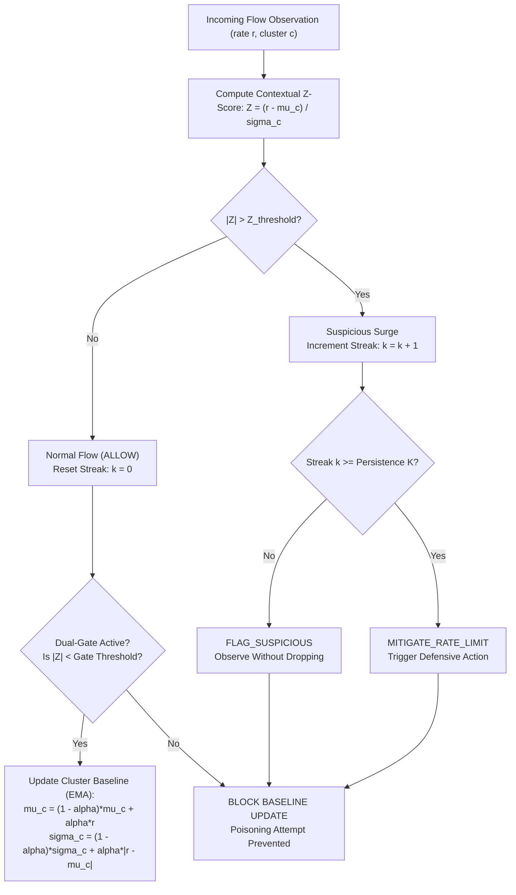

# Vehicular Communication Network (VCN) Research Methodology & Mathematical Formulation

## 1. Context & Research Problem

In Vehicular Ad-Hoc Networks (VANETs) and Cellular Vehicle-to-Everything (C-V2X) communication, vehicles exchange high-frequency telemetry messages (Basic Safety Messages / Cooperative Awareness Messages) with neighboring On-Board Units (OBUs) and roadside infrastructure (Roadside Units / RSUs).

A central security challenge in VCNs is distinguishing **benign traffic surges** (induced by vehicular clustering, traffic bottlenecks, and intersection congestion) from **malicious packet flooding attacks** (distributed denial-of-service aimed at exhausting channel bandwidth and receiver compute resources).

Conventional static threshold anomaly detectors evaluate packet arrival rates $\lambda$ against a fixed threshold $\theta_{static}$. In congested roadway segments, legitimate packet density surges naturally, causing static detectors to trigger false positives and discard critical safety messages.

---

## 2. Base Methodology (Khan et al., 2026 Reference Implementation)

FluxV2X reconstructs and benchmarks the spatiotemporal baseline discovery methodology established in:
> **Reference**: Khan et al. (2026). *"Spatiotemporal Contextual Anomaly Detection in Vehicular Ad-Hoc Networks"*. Evaluated against the Mendeley VCN Research Dataset ([DOI: 10.17632/2jvknhv465.1](https://doi.org/10.17632/2jvknhv465.1)).

### 2.1 Destination-Centric Spatiotemporal Clustering
Rather than evaluating packet arrivals globally across the entire network, receiver nodes are partitioned into localized spatial clusters using K-Means clustering on geographic coordinates:
$$\min_{\mathcal{C}} \sum_{c=1}^{k} \sum_{\mathbf{x}_i \in \mathcal{C}_c} \|\mathbf{x}_i - \boldsymbol{\mu}_c\|^2$$
where $\mathbf{x}_i = [x_i, y_i]^T$ represents the spatial coordinates of receiver $i$, and $\boldsymbol{\mu}_c$ is the centroid of cluster $c$.

### 2.2 Localized Statistical Baselines
For each receiver cluster $\mathcal{C}_c$, localized empirical statistics of packet arrival rates $r_i$ are computed over an initial observation window:
$$\mu_c = \frac{1}{|\mathcal{C}_c|} \sum_{i \in \mathcal{C}_c} r_i$$
$$\sigma_c = \sqrt{\frac{1}{|\mathcal{C}_c|} \sum_{i \in \mathcal{C}_c} (r_i - \mu_c)^2}$$

### 2.3 Contextual Z-Score Formulation
When a new packet observation with rate $r$ arrives for a node assigned to cluster $c$, the contextual z-score is calculated relative to the cluster's local baseline:
$$Z(r, c) = \frac{r - \mu_c}{\sigma_c + \epsilon}$$
where $\epsilon = 10^{-4}$ prevents division-by-zero instability in zero-variance conditions.

---

## 3. FluxV2X Proposed Extension: Adaptive Context-Aware Malicious Flooding Detection and Mitigation (ACAFDM)

While the base methodology uses static offline cluster baselines, real vehicular networks undergo continuous macro-traffic shifts (e.g., peak commuting hours, weather slowdowns). The FluxV2X platform introduces **ACAFDM**, an adaptive online engine with dual-gate poison prevention.

### 3.1 Persistence Streak Filter ($K$)
To avoid dropping packets during momentary benign traffic bursts, ACAFDM enforces a temporal persistence requirement:
$$\text{Decision}(r, c, k) = \begin{cases} 
\text{MITIGATE\_RATE\_LIMIT} & \text{if } |Z(r, c)| > Z_{thresh} \text{ and } k \ge K \\
\text{FLAG\_SUSPICIOUS} & \text{if } |Z(r, c)| > Z_{thresh} \text{ and } k < K \\
\text{ALLOW} & \text{if } |Z(r, c)| \le Z_{thresh}
\end{cases}$$

### 3.2 Dual-Gate Poison Prevention
Adaptive algorithms that blindly update their running mean are vulnerable to **adversarial baseline poisoning**, where an attacker gradually increases flooding rates over time to inflate $\mu_c$. ACAFDM incorporates a strict validation gate:
- Baseline updates are **strictly accepted** only when the observation is confirmed benign ($|Z| \le Z_{thresh}$).
- If an observation is flagged suspicious or mitigated, the baseline update is **blocked**, completely preserving the cluster baseline from contamination.
- When accepted, baselines adapt via Exponential Moving Average (EMA):
  $$\mu_c^{(t)} = (1 - \alpha)\mu_c^{(t-1)} + \alpha r$$
  $$\sigma_c^{(t)} = (1 - \alpha)\sigma_c^{(t-1)} + \alpha |r - \mu_c^{(t)}|$$

---

## 4. Paired McNemar Statistical Significance Testing

To verify whether model improvements are statistically significant or merely random artifacts, FluxV2X computes a two-tailed paired McNemar test:
$$\chi^2 = \frac{(|b - c| - 1)^2}{b + c}$$
where $b$ is the count of samples Model A classified correctly and Model B classified incorrectly, and $c$ is the count where Model B was correct and Model A was incorrect. A calculated $p$-value $< 0.05$ rejects the null hypothesis of equal performance.
